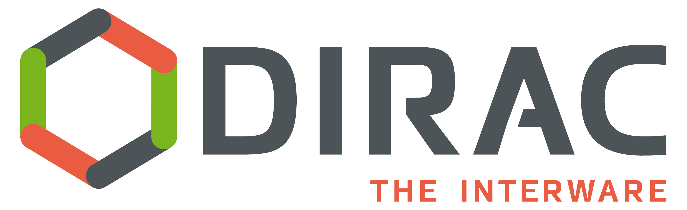
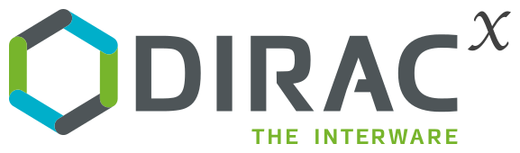
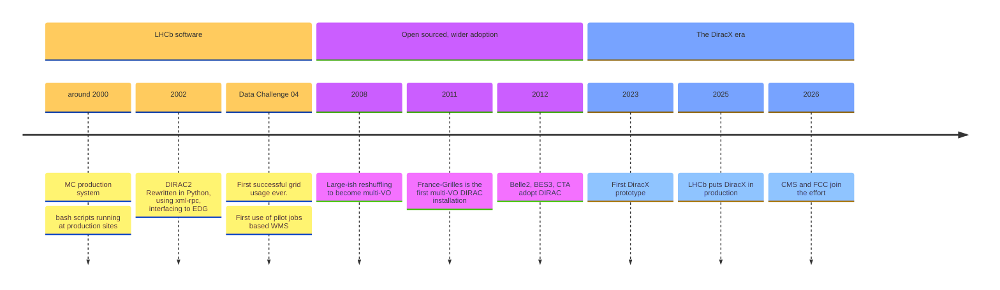
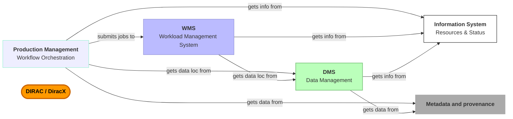
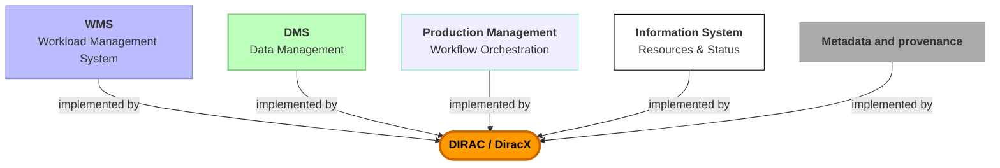
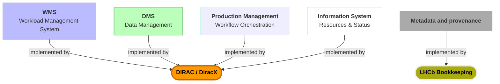
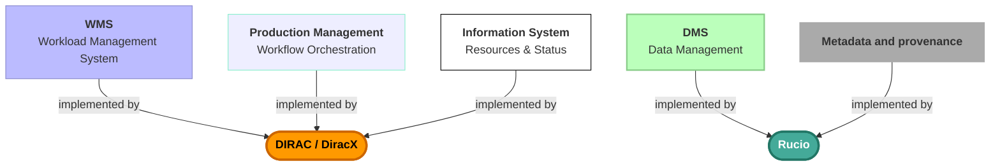
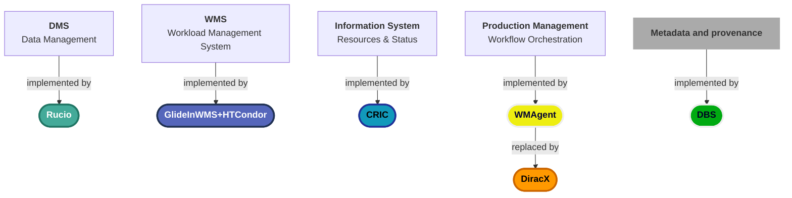
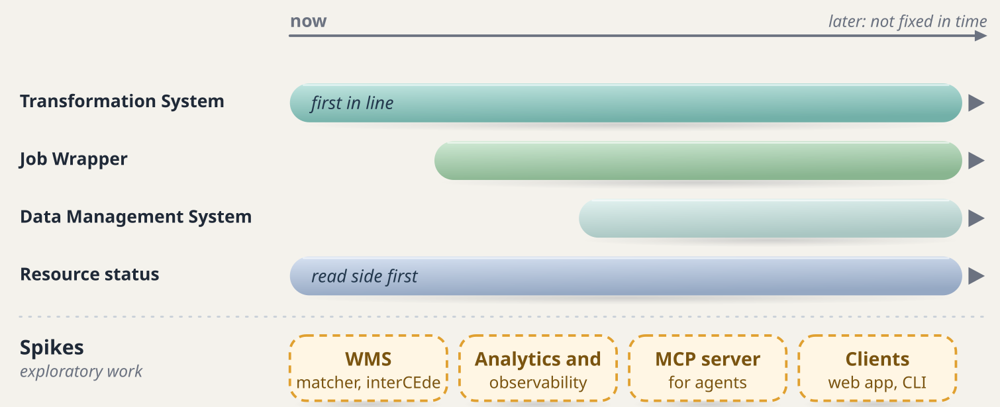

# DiracX as a Service for SMEs?
## Would you use it? And in which form?

**Federico Stagni** <Email v="federico.stagni@cern.ch" />

DiracGrid Technical Coordinator, CERN

 

CERN IT-SME Coordination Meeting, November 2026

<a href="https://indico.cern.ch/event/1745440/" class="ns-c-iconlink"><mdi-open-in-new />indico.cern.ch/event/1745440</a>

---
layout: top-title-two-cols
color: diracx-light
align: cm-lm-lm
title: diracgrid
columns: is-8
class: cols-split
---

:: title ::

# What is DiracGrid, actually?

:: left ::

An "**interware**" (a tool for doing distributed computing), started within LHCb 25 years ago (!).

Today used by a few dozens communities, for managing **jobs** (via pilots), **data**, **productions**, **dataset transfers**, ...

 

ATM the DiracGrid project develops and maintains 2 whole software stacks:
- [DIRAC](https://github.com/DIRACGrid/DIRAC) (the "legacy" workhorse) (+Web)
- [DiracX](https://github.com/DIRACGrid/diracx) (DIRAC's cloud-native rethink+rewrite)

  
  →
  

:: right ::

## Community

 

<AdmonitionType type=info>
Apart from the regular zoom meetings, we meet at <strong>3 hackathons per year</strong>, plus one <strong>workshop</strong> (the <a href="https://indico.cern.ch/event/1588323/">12th Dirac(X) Users' Workshop</a> was in Prague, October 2026)
</AdmonitionType>

 

Open source (Apache-2.0), developed in the open at [github.com/DIRACGrid](https://github.com/DIRACGrid)

---
layout: top-title
color: diracx-light
align: cm
title: story
---

:: title ::

# The shortened Dirac's story

:: content ::

---
layout: top-title
color: gray-light
align: c
title: core-functionalities
clicks: 4
---

:: title ::

## Core functionalities and tools (enormous simplification)

:: content ::

<v-switch>
<template #0>

### **Core functionalities**

 

</template>
<template #1>

# **JUNO**, **GridPP**
Small-medium installations that want an all-in-one system

Old DIRAC was largely monolithic. DiracX emphasizes modularity and well-defined APIs.

</template>
<template #2>

# **LHCb**
Not a small installation, but the oldest and carrying legacy.

</template>
<template #3>

# **Belle2**, **CTAO**, and **FCC**
The need for modularity comes also from existing DIRAC installations

</template>
<template #4>

# **CMS**
For CMS, modularity is a must.

</template>
</v-switch>

---
layout: top-title
color: diracx-light
align: cm
title: users
---

:: title ::

# Who uses it, today

:: content ::

A few dozens communities, of very different sizes:

- **Big** (and carrying legacy): **LHCb**, **Belle II** (KEK/BNL), **CTAO**, **CMS** (joining 2026)
- **Small-medium installations that want an all-in-one system**: **JUNO**, **GridPP**, **BES III**, **FCC** (joining 2026), ...
- Plus several **national/provincial cloud** installations and smaller experiments

 

<AdmonitionType type='info' >
Several of these are, in CERN terms, exactly "SMEs": they have the same data/production challenges as the big ones, with a fraction of the people
</AdmonitionType>

 

What they all got for granted: **pilots to Grid/HPC/cloud**, productions, data management, a Web UI, a CLI, and an API

---
layout: top-title-two-cols
color: diracx-light
align: cm-lm-lm
title: diracx
columns: is-8
---

:: title ::

#  Not a port: a **reimplementation**

:: left ::

**Cloud-native by design**
- Kubernetes-based deployments
- **OAuth2 / JWT tokens** (no x509 proxies), REST APIs everywhere
- Modular services, well-defined APIs
- **Multi-VO** as a first-class citizen

**New data model**
- The spine: **workgraph**, **transformations**, **parcels**
- Pluggable **compute backends**: pilots, HPC push, **HTCondor**, legacy DIRAC, ...

:: right ::

<AdmonitionType type='important' >
DIRAC is only **patched** meanwhile: all new developments happen in DiracX
</AdmonitionType>

- You move **one component at a time**, DIRAC and DiracX run in parallel
- LHCb has been in **production** on DiracX since 2025
- CMS and FCC joined the effort in 2026

From "DiracGrid software stacks" · <a href="https://indico.cern.ch/event/1628935/">RCW26</a> and <a href="https://indico.cern.ch/event/1588323/">DUW12</a>

---
layout: top-title
color: diracx-light
align: cm
title: status
---

:: title ::

# DiracX, status (late 2026)

:: content ::

- **New development process** since January 2026: SCRUM, 2-week sprints, monthly `DOps` with community representatives
- **ADRs for everything**: transparent, reviewable, community-driven design ([DX-ADR series](https://diracx.diracgrid.org/en/latest/adr/))
- The **Transformation System** (productions, the new heart) is being implemented, with scenario tests and a [playground](https://diracx.diracgrid.org/en/latest/playground/)
- **36 contributors**, **634 PRs** merged across DIRACGrid repositories since the last workshop, from **9 communities**

 

<AdmonitionType type='tip' >
Everything is public: roadmap, ADRs, [docs](https://diracx.diracgrid.org/), playground
</AdmonitionType>

From "DiracGrid software stacks" · <a href="https://indico.cern.ch/event/1628935/">RCW26</a>

---
layout: section
color: diracx
title: raas
---

# The blueprint: "Rucio as a Service" at CERN IT

---
layout: top-title-two-cols
color: diracx-light
align: cm-lm-lm
title: raas-what
columns: is-8
---

:: title ::

# RaaS: what CERN IT does for Rucio

:: left ::

**Rucio-as-a-Service**: a centrally managed, ready-to-use Rucio data management service for Small and Medium Experiments.

- **One cluster per community**, run by the Rucio IT team; each community's admins own their data and policies
- Next to the other CERN IT services: **EOS, CTA, FTS, CVMFS, PostgreSQL**
- A prototype in 2025, **in production today**

:: right ::

## Communities on board

 

**AMS-02**, **SHiP**, **n_TOF**, **FCC**, **NA62**, EOSC, RI-SCALE, RBAC, ...

 

<AdmonitionType type='info' >
"Same data challenges, but smaller teams": now one team runs Rucio for them all
</AdmonitionType>

From "Update on RaaS at CERN" · H. Gonzalez Labrador · <a href="https://indico.cern.ch/event/1628935/contributions/7313407/">RCW26</a>

---
layout: top-title-two-cols
color: diracx-light
align: cm-lm-lm
title: raas-numbers
columns: is-6
---

:: title ::

# RaaS: some numbers

:: left ::

  

9

Rucio clusters

  

20.3

petabytes

  

33.7

million files

  

46

RSEs

  

13

countries

  

770K

API requests/day

99% of the data at CERN, but RSEs as far as MIT

:: right ::

**Simple and stupid, by design:**

- One k8s (OpenStack Magnum) cluster per community, **not** multi-VO Rucio
- GitOps: state in Git, synced by **Argo CD**, secrets from **Vault**, self-healing
- Reuse services maintained by someone else (PostgreSQL, OpenStack, FTS, Vault)

<AdmonitionType type='tip' >
"Our job is to keep the backbone simple, reliable and cheap to run"
</AdmonitionType>

From "Update on RaaS at CERN" · H. Gonzalez Labrador · <a href="https://indico.cern.ch/event/1628935/contributions/7313407/">RCW26</a>

---
layout: top-title
color: diracx-light
align: cm
title: raas-why
---

:: title ::

# Why RaaS works for SMEs

:: content ::

- **Low barrier to adoption**: experiments write data into a designated disk pool; archiving, replication and policy enforcement happen automatically (an "illusion of an HSM")
- SMEs are **shielded from underlying technology changes** (x509→tokens, Tape REST API, TPC, ...)
- Support is streamlined: **from N×M discussions to N×1**
- SMEs declaratively set **what** they want to do with the data, not **how**
- A **blueprint for new experiments**: a production-grade DM environment from day one (e.g. SHiP)

From "Enabling SMEs with Rucio-as-a-Service" · H. Gonzalez Labrador · <a href="https://indico.cern.ch/event/1545309/contributions/6717953/">RCW25</a>

---
layout: section
color: diracx
title: question
---

# The question

---
layout: top-title
color: diracx-light
align: cm
title: the-question
---

:: title ::

# The question

:: content ::

### If CERN-IT would host a **DiracX-as-a-Service** instance for SMEs,
### in a fashion similar to what Rucio-as-a-Service is for data management...

 

# ...would SMEs be interested?

# And in which forms?

---
layout: top-title
color: diracx-light
align: cm
title: shape
---

:: title ::

# What it would look like (the shape)

:: content ::

Same philosophy as RaaS, different domain:

|  | **RaaS** (Rucio) | **DiracXaaS** (DiracX) |
|---|---|---|
| Domain | data management | **workload & production management** (+data management) |
| Deployment | one k8s cluster per community | one **DiracX deployment per community** |
| Run by | CERN IT Rucio team | CERN IT **DiracGrid** team |
| Backbone | EOS, CTA, FTS, PostgreSQL, Vault | CERN batch / LCG / HPC pilots, PostgreSQL, Vault |
| Onboarding | write data, define declarative rules | describe productions/jobs; the **Transformation System** runs them |
| Interface | CLI, Web UI, API | CLI, Web UI, API (same) |

<AdmonitionType type='important' >
SMEs would get production-grade WMS+productions, with no servers to run and no operators to hire
</AdmonitionType>

---
layout: top-title
color: diracx-light
align: cm
title: what-you-get
---

:: title ::

# What an SME would get

:: content ::

- **Workload management**: user jobs and productions dispatched via pilots to Grid (WLCG), HPC and cloud resources
- **Productions**: the DiracX Transformation System (workgraphs of transformations), the same machinery used by LHCb, CMS and FCC
- **Data management**, two options (not mutually exclusive):
  - DIRAC-style: file catalog (DFC), Storage Elements, transfers
  - or glued to **RaaS Rucio**: the Transformation System drives Rucio rules (the pattern already used by Belle II, CTAO, FCC, CMS)
- **Interfaces**: Web UI, CLI, API; **OAuth2** tokens; multi-VO
- **Monitoring, accounting, analytics** for your community

<AdmonitionType type='info' >
In short: what big experiments have, without operating it
</AdmonitionType>

---
layout: top-title
color: diracx-light
align: cm
title: why-diracx
---

:: title ::

# Why DiracX, and not DIRAC?

:: content ::

<AdmonitionType type='important' >
A hosted, shared service can only be built on **DiracX**.
</AdmonitionType>

- A service for many communities must be **cloud-native**: Kubernetes, REST APIs, OAuth2/tokens, multi-VO → that's exactly what DiracX is, and legacy DIRAC is not
- **DIRAC is in maintenance mode**: security patches and performance fixes, but all new developments happen in DiracX
- Starting an SME on DIRAC today would mean asking them to **migrate tomorrow**
- The new features SMEs care about (Transformation System, new compute backends, ...) **only land in DiracX**

 

<AdmonitionType type='tip' >
"DIRAC or DiracX?" is a fair question -- the answer is: **only DiracX**
</AdmonitionType>

---
layout: top-title
color: diracx-light
align: cm
title: forms
---

:: title ::

# "In which forms?" -- questions for you

:: content ::

- **Scope**: full WMS + productions? Analysis jobs only? With or without data management?
- **Compute resources**: which ones should be in scope? CERN batch, WLCG sites, HPC centres, cloud?
- **Data**: where would it live? EOS/CTA at CERN, RSEs at your sites, RaaS Rucio?
- **Deployment model**: one deployment per community (RaaS style)? Or a single multi-VO DiracX instance?
- **Support & cost**: what level of service do you expect? What is a sustainable model?
- **Onboarding**: would your data/production workflows fit the Transformation System model?

 

<AdmonitionType type='info' >
The answer to these questions defines the service: your input is needed!
</AdmonitionType>

---
layout: top-title
color: diracx-light
align: cm
title: synergy
---

:: title ::

# Synergy with RaaS: a one-stop shop

:: content ::

The DiracX--Rucio interplay is already a working pattern for the big communities:

- **Belle II**: Rucio as file catalog + DDM; DIRAC jobs read/write via the `RucioFileCatalog` plugin
- **CTAO**: Dirac(X) for WMS/TS and **Rucio for data management**, in the same k8s deployment
- **FCC** and **CMS**: Rucio as the DMS, DiracX taking over workflow management

 

For SMEs, CERN IT could offer both:

<AdmonitionType type='tip' >
**DiracXaaS for jobs and productions + RaaS for data** = the full stack, operated by the same IT department
</AdmonitionType>

From "DiracGrid software stacks" · <a href="https://indico.cern.ch/event/1628935/">RCW26</a>

---
layout: top-title-two-cols
align: cm-cm-lm
color: diracx-light
columns: is-4
title: summary
---
:: title ::

# Summary

:: left ::

 </img>

:: right ::

<ul class="text-base">
  <li>DiracGrid provides DIRAC and DiracX: distributed computing for a few dozens communities, from SME-like installations to the big LHC ones.
    <ul class="text-sm">
      <li>DiracX is the future: cloud-native, modular, multi-VO; DIRAC only patched meanwhile</li>
    </ul>
  </li>
  <li>CERN IT already runs Rucio-as-a-Service for SMEs: production-grade data management with no operational overhead.
    <ul class="text-sm">
      <li>The same model could work for workload and production management</li>
    </ul>
  </li>
  <li>The question: would a <strong>DiracX-as-a-Service</strong> for SMEs be useful? In which form?
    <ul class="text-sm">
      <li>Only DiracX-based, of course 😉</li>
      <li>Your input defines the scope: jobs, productions, data, resources, support model</li>
    </ul>
  </li>
</ul>

---
layout: section
color: diracx
title: Questions
---

# Questions? / Discussion

---
layout: section
color: diracx
title: backup
---

# Backup

---
layout: top-title-two-cols
color: diracx-light
align: cm-lm-lm
title: raas-ops
columns: is-6
---

:: title ::

# Backup: RaaS operations

:: left ::

**Infrastructure (Oct. 2026):**

- 9 Rucio clusters + 1 for Argo CD, 78 nodes/VMs
- 464 CPU cores (3% used), 833 GiB RAM (30% used)
- 1,345 running pods; 105 namespaces, only 129 Rucio daemon pods

**Operations:**

- 41 Argo CD applications, synced from Git, self-healing
- 770K API requests a day, 14.5M log lines a day
- Logs in Loki (30 days) and on file (1 year), 10.5 GB/day
- Monitoring: Prometheus + Grafana, 4 linked dashboards; scripts and AI condense signals and apply actions

:: right ::

<AdmonitionType type='info' >
Mostly operations: the RaaS team also contributes to upstream Rucio development
</AdmonitionType>

One Rucio cluster per community keeps things **simple**: one conf file per cluster, standard deployment (`rucio-<deployment>`), all under `*.rucioit.cern.ch`

From "Update on RaaS at CERN" · H. Gonzalez Labrador · <a href="https://indico.cern.ch/event/1628935/contributions/7313407/">RCW26</a>

---
layout: top-title
color: diracx-light
align: cm
title: roadmap
---

:: title ::

# Backup: the DiracX roadmap

:: content ::

<AdmonitionType type='important' >
Priorities, not commitments. New requirements can reorder this page, and the team writes the detailed plan.
</AdmonitionType>

From "DiracX developments: directions" · A. Boyer · <a href="https://indico.cern.ch/event/1588323/contributions/7301774/">DUW12</a>

---
layout: top-title
color: diracx-light
align: cm
title: ts-usecases
---

:: title ::

# Backup: the Transformation System, in one slide

:: content ::

> A **workgraph** is a directed acyclic graph of **transformations**. Each transformation maintains a pool of **inputs**: a **feeder** tops up the pool, a **packer** groups pooled inputs into **parcels**, and a **dispatcher** hands each parcel to a compute or data **backend**, which executes it as a job or a request. -- DX-ADR-002

- Everything **composes**: each use case changes only the shape of the graph, and which feeder, packer and actions are plugged in
- **Compute backends** are pluggable: native pilots, push to HPC, HTCondor, legacy DIRAC, ...
- User jobs take the same path as productions

From "The DiracX Transformation System" · C. Burr · <a href="https://indico.cern.ch/event/1588323/contributions/7264643/">DUW12</a>
